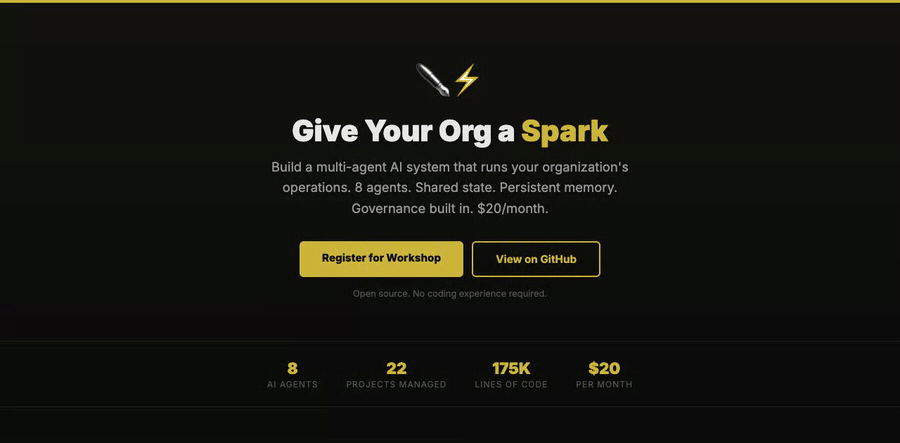

# Spark

Spark is a set of AI agents, run through Claude Code, that keeps an organization's work moving. You talk to one entry point, and it hands the job to the right agent.



Workshop and live page: [spark.radicalimagination.xyz](https://spark.radicalimagination.xyz). There's also a [30-second demo video](https://radicalimagination.xyz/demos/spark.mp4), silent with captions.

Radical Imagination, a cultural technology studio in Queens, runs on Spark. It has agents for grants, curriculum, archives, cultural review, outreach and the portfolio. They all read and write the same state files, and anything about culture or history goes through a review before it ships.

This repo is a template. Fork it and set it up for your own organization.

---

## What's in the template

```
├── CLAUDE.md                    # Your org's instructions for Claude Code
├── QUICKSTART.md                # 15-minute setup guide
├── GOVERNANCE.md                # Operational governance model
├── state/
│   ├── org-state.md             # Priorities, active projects, deadlines
│   ├── portfolio.md             # Every project with status
│   ├── last-session.md          # 15-line quick-start for every session
│   ├── decision-journal.md      # Every decision with reasoning
│   └── roster.md                # People, roles, connections
├── agents/
│   ├── router.md                # How Spark routes to the right agent
│   ├── grant-writer.md          # Sample: grant strategy agent
│   ├── content-creator.md       # Sample: content/social agent
│   └── reviewer.md              # Sample: QA/validation agent
├── memory/
│   ├── MEMORY.md                # Cross-session memory index
│   └── example-feedback.md      # Sample memory entry
├── protocol/
│   ├── session-start.md         # What happens at the start of every session
│   └── session-close.md         # What happens at the end of every session
├── docs/
│   ├── agent-spec-standard.md   # How to define agents (the portable format)
│   ├── open-infrastructure.md   # How .claude/ works as an OS
│   ├── positioning.md           # How Spark differs from CrewAI, LangGraph, AutoGPT
│   ├── honest-failures.md       # What went wrong and what the system learned
│   └── case-study-dubois-does-data.md  # One project through all 8 agents
└── examples/
    ├── money-agent-grant-strategy.md   # Real grant strategy output
    ├── validator-review.md             # Real cultural validation review
    └── cross-project-scan.md           # Real portfolio-wide intelligence scan
```

## The agents at Radical Imagination

| Agent | What it does |
|-------|-------------|
| Curriculum Architect | Designs learning experiences |
| Money Agent | Grant strategy and funder research |
| Cultural Archivist | Keeps source registries and provenance |
| Cultural Validator | Reviews work for cultural and historical accuracy |
| Technical Mentor | Code guidance and learning paths |
| Collective Manager | Roster, portfolio and onboarding |
| Impact & Engagement | Reports, social media and content |
| Commercial Strategist | Evaluates paid opportunities |

All eight share the same state files, the same memory and the same rules.

## How it works

1. You ask Spark for something.
2. Spark passes the request to the agent that handles it.
3. The agent reads the state files: your portfolio, priorities, people and past decisions.
4. When it's done, it updates those files, so the organization's record stays current.
5. Your corrections and preferences are saved as memory and carry into the next session.
6. Each session starts by reading the state and checking for contradictions, and ends by updating the state and drafting a morning email.

Because the state files hold everything, someone new can read them and pick up the work.

## Quick start

### What you need
- A [Claude Code](https://claude.ai/code) subscription (about $20 a month)
- A text editor (VS Code, Cursor or any other)
- A Gmail account, for drafting email through MCP
- A project or organization to set Spark up for

### Setup (about 15 minutes)

```bash
# 1. Fork this repo
gh repo fork ShdwSpde/spark-workshop-template --clone

# 2. Open in your editor
cd spark-workshop-template
code .

# 3. Customize CLAUDE.md with your org's name and instructions
# 4. Fill in state/org-state.md with your real projects and priorities
# 5. Design your agents in agents/ (start with 3, expand to 5-8)
# 6. Add 3-5 initial memories to memory/

# 7. Start Claude Code and load your project
claude

# 8. Your first prompt:
# "Read CLAUDE.md and the state files. What's the status of my projects?"
```

### Things to ask in your first session

- "What's the status of my projects?"
- "Draft a grant strategy for [funder]"
- "Review this [document] for [criteria]"
- "Draft an email to [person] about [topic]"
- "What decisions have we made this month?"
- "What's out of date? What needs attention?"

## How the pieces connect

```
┌─────────────────────────────────────────┐
│                 YOU                      │
│                    │                     │
│                    ▼                     │
│               ┌─────────┐               │
│               │  SPARK   │  ← Router    │
│               │  (CAO)   │               │
│               └────┬─────┘               │
│         ┌──────────┼──────────┐          │
│         ▼          ▼          ▼          │
│    ┌─────────┐ ┌─────────┐ ┌─────────┐  │
│    │ Agent 1 │ │ Agent 2 │ │ Agent 3 │  │
│    └────┬────┘ └────┬────┘ └────┬────┘  │
│         │          │          │          │
│         ▼          ▼          ▼          │
│    ┌────────────────────────────────┐    │
│    │     STATE FILES (markdown)     │    │
│    │  portfolio, priorities, log    │    │
│    │  decisions, people, memory     │    │
│    └────────────────────────────────┘    │
│                    │                     │
│              ┌─────┴─────┐               │
│              │  TOOLS    │               │
│              │ Gmail MCP │               │
│              │ Calendar  │               │
│              │ Git/Deploy│               │
│              └───────────┘               │
└─────────────────────────────────────────┘
```

## How we run it

1. Set it up yourself. You'll understand the system by building it for your own work, so start with the template and change it as you go.
2. Keep it to eight agents or fewer. Improve the agents you have before adding new ones.
3. Keep the state files up to date. They are what the AI knows about your organization at the start of each session.
4. Spark drafts and a person sends. Emails and posts stay drafts until someone reviews them.
5. Start and end every session the same way: read the state and check for contradictions; then update the state and draft the morning email.
6. Correct it when it's wrong. Spark saves corrections as memory, so they carry forward.

## Workshops

We teach Spark in three formats:

- A 60-minute talk: how Spark was built, how it's put together, live demos and Q&A.
- A 3-hour workshop: you build your own and leave with a working system.
- A full-day intensive, covering cross-project scans, contradiction checks and scenario planning.

Workshop materials and facilitator guides are at [radicalimagination.xyz/spark](https://radicalimagination.xyz/spark) (password-protected for attendees). To book a workshop, email create@radicalimagination.xyz.

Made by [Radical Imagination](https://radicalimagination.xyz), a cultural technology studio in Queens.
